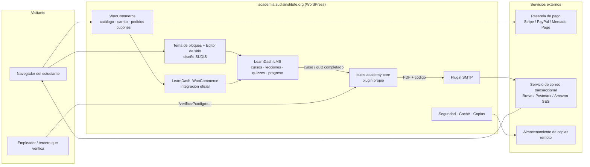
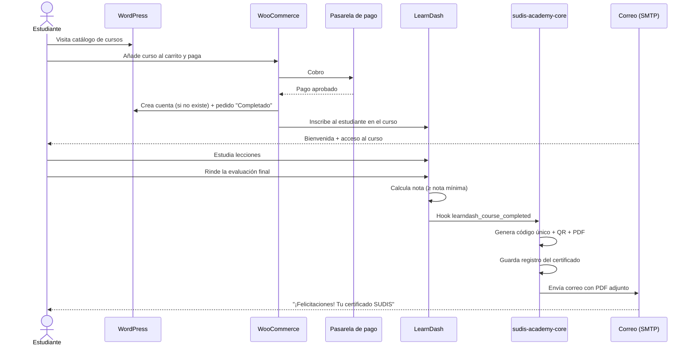
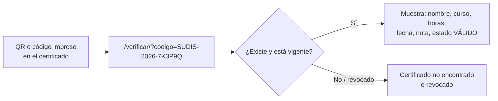
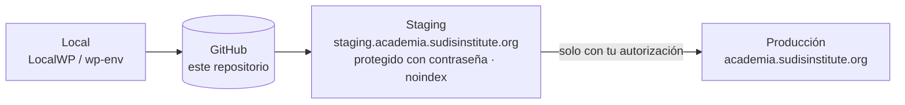

# 1. Arquitectura de SUDIS Academy

## 1.1 Objetivos funcionales

| Objetivo | Cómo se resuelve |
|----------|------------------|
| Los estudiantes se registran | Registro de LearnDash / WooCommerce + correo de bienvenida |
| Compran cursos | WooCommerce (pasarelas Stripe / PayPal / locales) → inscripción automática en LearnDash |
| Estudian y completan evaluaciones | Cursos, lecciones, temas y cuestionarios (*quizzes*) de LearnDash |
| Reciben un certificado PDF personalizado por correo | Plugin propio `sudis-academy-core`: genera PDF, asigna código único, lo adjunta por correo |
| Terceros verifican el certificado | Página pública `/verificar` con código o QR (como Educadis) |

## 1.2 Decisión de despliegue: ¿dónde vive la academia?

Para cumplir la regla de **no tocar el sitio actual**, se recomienda:

**Opción recomendada — instalación separada en subdominio**
`academia.sudisinstitute.org` (o `academy.`), con su propia instalación de WordPress.

- ✅ Cero riesgo para el sitio institucional actual (otra base de datos, otros plugins).
- ✅ LearnDash + WooCommerce cargan muchos recursos; aislados no ralentizan el sitio principal.
- ✅ Se puede probar, romper y reinstalar sin afectar nada.
- ➖ El sitio principal solo necesita (cuando autorices) un enlace/menú "Academia".
- ➖ Las cuentas de usuario son independientes del sitio principal (normalmente no es un problema: los estudiantes solo usan la academia).

**Alternativa — misma instalación de `sudisinstitute.org`**
Solo si necesitas que los mismos usuarios del sitio actual entren a los cursos.
Implica instalar plugins en el sitio en producción, por lo que exigiría tu
autorización explícita en cada paso y un staging clonado del sitio actual.

> La guía asume la opción recomendada. Si prefieres la alternativa, los pasos son
> los mismos pero el staging se crea **clonando** el sitio actual.

## 1.3 Diagrama de componentes

## 1.4 Flujo principal del estudiante

## 1.5 Flujo de verificación pública

## 1.6 Modelo de datos

LearnDash ya guarda cursos, lecciones, quizzes, progreso e intentos. WooCommerce
guarda productos, pedidos y clientes. El plugin propio solo añade **una tabla**
para los certificados emitidos:

**Tabla `wp_sudis_certificates`**

| Campo | Tipo | Descripción |
|-------|------|-------------|
| `id` | BIGINT PK | Identificador interno |
| `code` | VARCHAR(32) UNIQUE | Código público, p. ej. `SUDIS-2026-7K3P9Q` |
| `user_id` | BIGINT | Estudiante (WordPress) |
| `course_id` | BIGINT | Curso LearnDash |
| `quiz_id` | BIGINT NULL | Evaluación que lo habilitó (opcional) |
| `student_name` | VARCHAR(190) | Nombre tal como se imprimió (inmutable) |
| `course_title` | VARCHAR(255) | Título tal como se imprimió (inmutable) |
| `hours` | SMALLINT | Carga horaria |
| `score` | DECIMAL(5,2) NULL | Nota obtenida |
| `issued_at` | DATETIME | Fecha de emisión |
| `status` | ENUM('valid','revoked') | Estado |
| `file_path` | VARCHAR(255) | Ruta del PDF en carpeta protegida |
| `emailed_at` | DATETIME NULL | Última vez que se envió por correo |

Se guardan copias del nombre y título para que el certificado verificado siempre
coincida con el PDF impreso, aunque luego cambie el curso o el perfil.

Metadatos adicionales por curso (campos del curso en el editor):

- `_sudis_hours` — carga horaria.
- `_sudis_certificate_template` — plantilla de diseño a usar.
- `_sudis_signatories` — firmas/cargos que aparecen en el certificado.

## 1.7 Entornos

| Entorno | Uso | Datos |
|---------|-----|-------|
| Local | Desarrollo del plugin propio | Ficticios |
| Staging | Pruebas completas, pagos en modo *test*, revisión tuya | Ficticios |
| Producción | Estudiantes reales | Reales |

## 1.8 Requisitos técnicos del hosting

- PHP 8.1 o superior, MySQL 8 / MariaDB 10.6+, HTTPS.
- `memory_limit` ≥ 256 MB, `max_execution_time` ≥ 120 s.
- Extensiones PHP: `gd` o `imagick`, `mbstring`, `dom`, `zip` (necesarias para PDF y QR).
- Cron real del servidor (no depender solo de WP-Cron) para envíos de correo en cola.
- Staging con un clic (la mayoría de hostings gestionados lo ofrecen).
- Copias de seguridad diarias.

## 1.9 Seguridad y privacidad

- Los PDF se guardan **fuera del acceso público directo** (carpeta con `.htaccess`
  `deny`/regla Nginx) y se descargan mediante un enlace con permiso.
- La página de verificación solo muestra datos mínimos (nombre, curso, fecha,
  estado), nunca correo ni documento de identidad.
- Política de privacidad y términos aceptados en el registro y en el *checkout*.
- Autenticación en dos pasos para administradores; roles separados
  (Administrador, Instructor/Group Leader, Estudiante).
