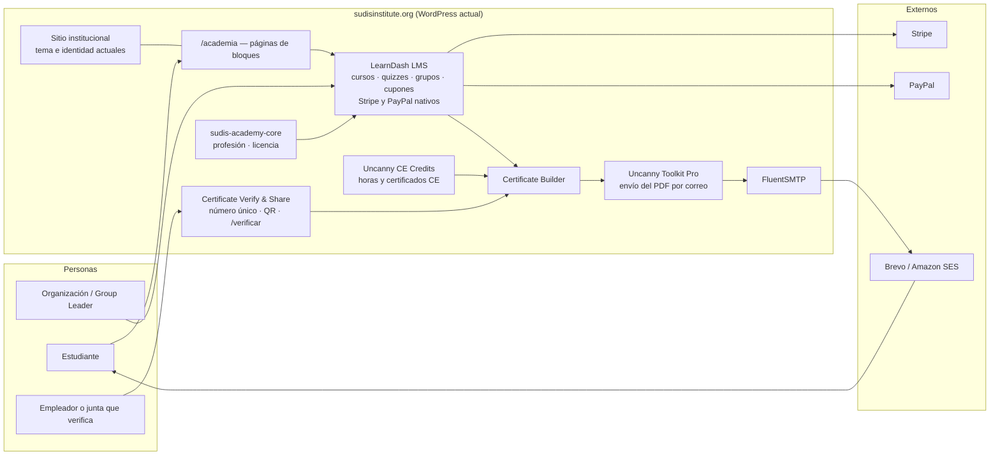
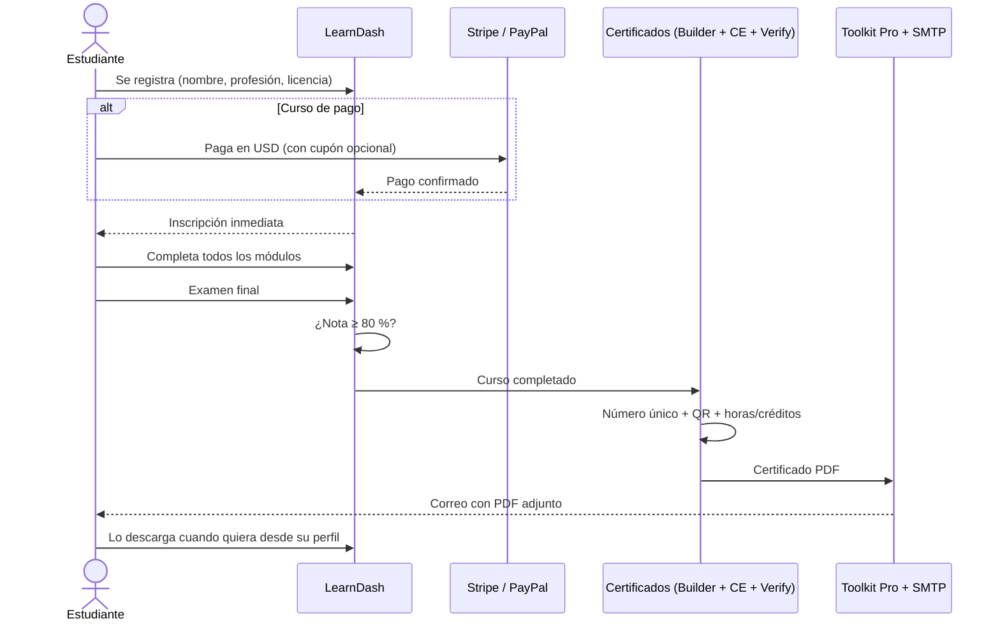
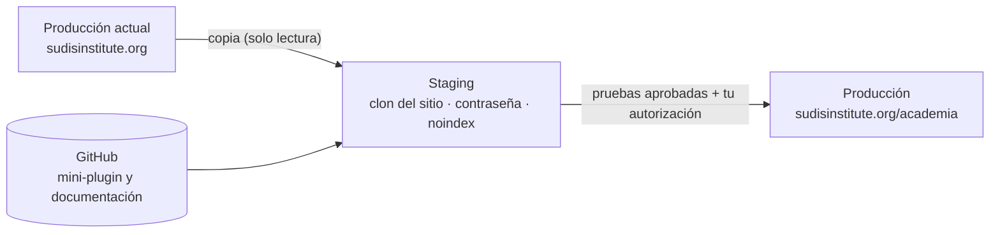

# 1. Arquitectura de SUDIS Academy (v2)

> v2 — Actualizada con tus decisiones: academia **dentro del sitio actual** en
> `sudisinstitute.org/academia`, desarrollo solo en **staging**, público de
> Puerto Rico y EE. UU., cobro en **USD**, y prioridad a **funciones nativas de
> LearnDash y extensiones compatibles** antes que código propio.

## 1.1 Requisitos y cómo se cubren

| Requisito | Solución propuesta | Tipo |
|-----------|--------------------|------|
| Registro de estudiantes | Registro de LearnDash | Nativo |
| Profesión y nº de licencia | Campos extra de registro/perfil | Mini-plugin propio (pequeño) |
| Cursos gratuitos y de pago | Modos de acceso *Abierto/Gratis* y *Comprar ahora* | Nativo |
| Tarjeta crédito/débito (Stripe) | Stripe Connect de LearnDash | Nativo |
| PayPal (opcional) | PayPal de LearnDash | Nativo |
| Cupones | Cupones de LearnDash | Nativo |
| Matrícula grupal para organizaciones | Grupos de LearnDash + *Group Leader* (fase 1); compra de plazas *self-service* con Uncanny Groups (fase 2) | Nativo → Extensión |
| Evaluación final ≥ 80 % | Quiz final con nota de aprobación 80 % como último paso del curso | Nativo |
| Certificado al completar módulos **y** aprobar | Certificado de curso (se otorga al completar todos los pasos, incluido el quiz) | Nativo |
| Diseño propio del certificado | LearnDash Certificate Builder (bloques) | Add-on oficial gratuito |
| Horas contacto / educación continua | Uncanny Continuing Education Credits | Extensión |
| Finalización vs. educación continua acreditada | Dos plantillas de certificado; los cursos acreditados usan la de CE | Nativo + extensión |
| Envío automático del PDF por correo | Uncanny Toolkit Pro → *Email Course Certificates* (o el envío de Uncanny CE) | Extensión |
| Conservar el certificado en su perfil | Perfil de LearnDash (descarga) + "Mis certificados" | Nativo |
| Número único + QR + verificación pública | WooNinjas *LearnDash Certificate Verify & Share* | Extensión |
| Correo fiable | FluentSMTP + servicio transaccional | Gratis / uso |

**Conclusión:** casi todo se logra con LearnDash y 3 extensiones. Solo se necesita
código propio para los **campos de profesión y licencia** (y quizá para formatear
el número de certificado). El plugin propio de certificados completo queda como
**plan B** si las extensiones no superan las pruebas en staging.

## 1.2 Ubicación: `sudisinstitute.org/academia`

La academia vive en el **mismo WordPress** que el sitio institucional.

| URL | Contenido |
|-----|-----------|
| `/academia/` | Página de inicio de la academia (diseñada con bloques) |
| `/academia/cursos/` | Catálogo de cursos |
| `/academia/cursos/{curso}/` | Ficha del curso; lecciones y quiz cuelgan de aquí |
| `/academia/mi-cuenta/` | Panel del estudiante: cursos, progreso, certificados |
| `/academia/organizaciones/` | Información y solicitud de matrículas grupales |
| `/academia/verificar/` | Verificación pública de certificados |

> Los *slugs* de LearnDash se configuran en *LearnDash → Ajustes → Enlaces
> permanentes*. Se probará en staging si acepta el prefijo `academia/`; si no,
> el catálogo quedará en `/cursos/` y la portada en `/academia/`.

Riesgos de integrar en el sitio actual, y cómo se controlan:

| Riesgo | Control |
|--------|---------|
| Un plugin nuevo rompe el sitio publicado | Todo se prueba antes en staging; copia completa antes de pasar a producción |
| Más carga en el servidor | Revisar recursos del hosting (Fase 0); caché que excluya páginas de cursos y pago |
| Conflictos con el tema o plugins actuales | Inventario de plugins actuales en Fase 0 y pruebas en staging |
| Usuarios estudiantes en el mismo WordPress | Rol *Suscriptor/Estudiante* sin acceso al escritorio; 2FA para administradores |

## 1.3 Diagrama de componentes

## 1.4 Flujo del estudiante

## 1.5 Tipos de certificado

| | Certificado de finalización | Certificado de educación continua acreditada |
|---|---|---|
| Uso | Cursos no acreditados | Cursos aprobados por una junta/entidad acreditadora |
| Título | "Certificado de Finalización" | "Certificado de Educación Continua" |
| Horas | Horas contacto del curso | Horas contacto + créditos CE/CEU |
| Datos extra | — | Nº de proveedor/aprobación, entidad acreditadora, profesión y licencia del participante |
| Plantilla | `SUDIS – Finalización` | `SUDIS – Educación Continua` |

Cada curso tiene asignada una de las dos plantillas.

> Para cursos acreditados en Puerto Rico o EE. UU., la junta correspondiente
> suele exigir datos concretos en el certificado (nº de proveedor, horas,
> fecha, firma). Confirma esos requisitos con cada entidad acreditadora antes de
> cerrar el diseño de la plantilla CE.

## 1.6 Entornos

## 1.7 Requisitos técnicos

- PHP 8.1+, WordPress 6.8+ (requisito de Certificate Verify & Share), MySQL 8 / MariaDB 10.6+, HTTPS.
- `memory_limit` ≥ 256 MB; extensiones `gd`/`imagick`, `mbstring` (PDF y QR).
- Cron real del servidor para los correos.
- Webhooks de Stripe accesibles (no bloqueados por firewall).

## 1.8 Seguridad y privacidad

- El número de licencia es dato personal: se muestra en el certificado, pero **no**
  en la página pública de verificación (solo nombre, curso, horas, fecha, estado).
- 2FA para administradores; estudiantes sin acceso al escritorio de WordPress.
- Pagos en Stripe/PayPal: los datos de tarjeta nunca pasan por el servidor.
- Copias diarias con destino fuera del servidor.
