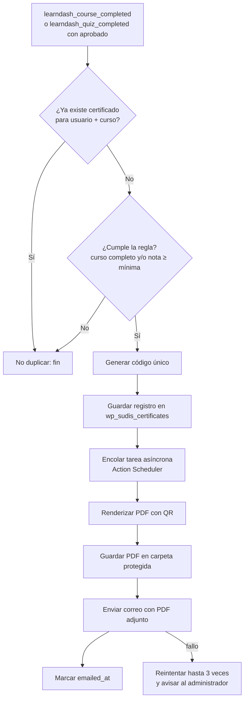

# 4. Sistema de certificados (tipo Educadis)

## 4.1 Qué ofrece LearnDash de serie y qué falta

| Necesidad | LearnDash nativo | Plugin `sudis-academy-core` |
|-----------|------------------|-----------------------------|
| Certificado PDF al completar curso/quiz | ✅ (se genera al hacer clic en "Descargar") | ✅ generado y **guardado** al momento de aprobar |
| Diseño personalizado | Parcial (imagen de fondo + texto con shortcodes) | ✅ plantilla HTML/CSS completa: logos, firmas, horas, nota |
| **Envío automático por correo con PDF adjunto** | ❌ (solo enlace, con add-ons) | ✅ |
| **Código único de verificación** | ❌ | ✅ `SUDIS-AAAA-XXXXXX` |
| **QR + página pública de verificación** | ❌ | ✅ `/verificar/` |
| Registro histórico inmutable, revocación, reemisión | ❌ | ✅ |

## 4.2 Componentes del plugin

```
wp-content/plugins/sudis-academy-core/
├── sudis-academy-core.php        # Cabecera del plugin, carga, activación (crea tabla)
├── composer.json                 # dompdf/dompdf, chillerlan/php-qrcode
├── includes/
│   ├── class-installer.php       # Tabla wp_sudis_certificates, carpeta protegida
│   ├── class-issuer.php          # Escucha hooks de LearnDash y emite el certificado
│   ├── class-code-generator.php  # Códigos únicos no adivinables
│   ├── class-pdf-renderer.php    # Plantilla → PDF (Dompdf) con QR embebido
│   ├── class-mailer.php          # Correo HTML con PDF adjunto (wp_mail)
│   ├── class-verification.php    # Shortcode/bloque [sudis_verificar] + endpoint
│   ├── class-student-area.php    # "Mis certificados" en el panel del estudiante
│   ├── class-course-meta.php     # Horas, plantilla y firmantes por curso
│   └── admin/class-admin-list.php# Listado, búsqueda, reenviar, revocar, reemitir
├── templates/
│   ├── certificate-default.php   # Diseño del certificado (A4 horizontal)
│   └── email-certificate.php     # Diseño del correo
└── assets/                       # Logos, firmas, fuentes con soporte para tildes/ñ
```

## 4.3 Lógica de emisión



Decisiones de diseño:

- **Asíncrono:** generar PDF y enviar correo no debe bloquear la pantalla del
  estudiante al terminar el examen. Se usa *Action Scheduler* (viene con WooCommerce).
- **Idempotente:** un único certificado por usuario + curso; si se reintenta, se reutiliza.
- **Inmutable:** el nombre y curso impresos se guardan en la tabla; reemitir genera un
  nuevo código y revoca el anterior.
- **Códigos no adivinables:** alfabeto sin caracteres ambiguos (sin 0/O, 1/I),
  generados con `random_int()`, comprobando unicidad en la tabla.

## 4.4 Esbozo de código (referencia para la Fase 7)

> Esbozo para validar el diseño; la implementación definitiva se hará y probará en
> la Fase 7. Los nombres de hooks son los documentados por LearnDash; se
> verificarán contra la versión instalada.

```php
// includes/class-issuer.php (extracto)
add_action( 'learndash_course_completed', function ( $data ) {
    $user_id   = $data['user']->ID;
    $course_id = $data['course']->ID;
    \Sudis\Academy\Issuer::maybe_issue( $user_id, $course_id );
} );

add_action( 'learndash_quiz_completed', function ( $quiz_data, $user ) {
    if ( empty( $quiz_data['pass'] ) || empty( $quiz_data['course'] ) ) {
        return;
    }
    $quiz_id = is_object( $quiz_data['quiz'] ) ? $quiz_data['quiz']->ID : (int) $quiz_data['quiz'];
    \Sudis\Academy\Issuer::maybe_issue(
        $user->ID,
        $quiz_data['course']->ID,
        $quiz_id,
        (float) $quiz_data['percentage']
    );
}, 10, 2 );
```

```php
// includes/class-mailer.php (extracto)
$sent = wp_mail(
    $user->user_email,
    sprintf( '¡Felicitaciones! Tu certificado de %s', $cert->course_title ),
    $html_body,
    array( 'Content-Type: text/html; charset=UTF-8' ),
    array( $cert->file_path ) // PDF adjunto
);
```

## 4.5 Diseño del certificado (a definir contigo)

Formato A4 horizontal. Elementos propuestos:

- Logo SUDIS Institute (y de aliados si aplica).
- Título: "CERTIFICADO DE APROBACIÓN" / "DE PARTICIPACIÓN".
- "Se otorga a **NOMBRE COMPLETO**", documento de identidad (opcional).
- "Por haber completado y aprobado el curso **TÍTULO DEL CURSO**".
- Carga horaria, nota final, fecha de emisión, ciudad.
- Firmas digitalizadas y cargos (1–3 firmantes).
- Código de verificación + QR + texto "Verifique en sudisinstitute.org/verificar" (o en el subdominio de la academia).
- Fondo/borde con la identidad gráfica SUDIS.

Necesito de ti: logo vectorial, firmas escaneadas en PNG con fondo transparente,
nombres/cargos de firmantes y, si tienes, un certificado actual de referencia.

## 4.6 Correo del certificado

- **Asunto:** ¡Felicitaciones! Tu certificado de {curso}
- **Cuerpo:** saludo con el nombre, mensaje de felicitación, código de verificación,
  botón "Verificar certificado", botón "Ir a mi panel", invitación a otros cursos.
- **Adjunto:** `Certificado-SUDIS-{codigo}.pdf`
- **Remitente:** `academia@sudisinstitute.org` (configurado en SMTP con SPF/DKIM/DMARC).

## 4.7 Plan B sin código (mientras se desarrolla el plugin)

Si necesitas lanzar antes de terminar la Fase 7:

1. Certificado nativo de LearnDash con imagen de fondo SUDIS y shortcodes
   (`[usermeta field="display_name"]`, `[courseinfo show="course_title"]`,
   `[courseinfo show="completed_on" format="d/m/Y"]`).
2. Envío por correo del PDF con un add-on (p. ej. el módulo de envío de certificados
   de Uncanny Toolkit Pro) o, al menos, enlace de descarga con LearnDash Notifications.
3. Sin verificación pública hasta que esté el plugin propio; luego se pueden
   generar retroactivamente los códigos para los certificados ya emitidos.
