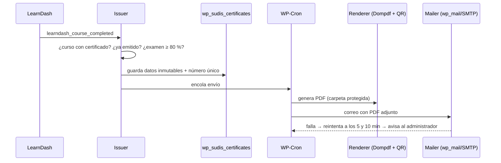

# 5. Instalación de SUDIS Academy

## 5.1 Qué está construido

El plugin **`sudis-academy-core`** (en `wp-content/plugins/sudis-academy-core/`) ya
cubre el sistema de certificados completo **solo con LearnDash**, sin las
extensiones de pago (Uncanny Toolkit Pro, Uncanny CE Credits, WooNinjas Verify &
Share). Así se ahorran sus licencias anuales.

| Función | Estado |
|---|---|
| Campos de profesión y nº de licencia en el registro, el perfil del escritorio y "Mi cuenta" | ✅ Probado |
| Ajustes por curso: tipo (finalización o educación continua), horas contacto, créditos CEU, entidad acreditadora, nº de proveedor, examen final | ✅ |
| Emisión automática al completar el curso **y** aprobar el examen con **≥ 80 %** | ✅ Probado (92 % emite, 70 % no emite, no duplica) |
| Número único `SUDIS-2026-XXXXXXXX` (no secuencial, no adivinable) | ✅ Probado |
| PDF A4 horizontal con logotipo, nombre, profesión, licencia, curso, horas, fecha, firma y QR | ✅ Probado |
| Correo automático con el PDF adjunto (en segundo plano, 3 reintentos y aviso al administrador) | ✅ Probado |
| "Mis certificados" con descarga protegida (solo el dueño o un administrador) | ✅ Probado |
| Página pública de verificación (válido / revocado / no encontrado), sin mostrar la licencia | ✅ Probado |
| Escritorio: listado, búsqueda, reenviar, regenerar PDF, revocar, restaurar, emisión manual, ajustes, vista de muestra | ✅ |
| Páginas `/academia/`, `/academia/mi-cuenta/`, `/academia/verificar/`, `/academia/organizaciones/` | ✅ Script `scripts/setup-academy.php` |

**Pendiente de tu parte:** licencia de LearnDash, acceso al staging de tu
hosting, logotipo, firma y datos de acreditación.

## 5.2 Probarlo en local (sin tocar ningún sitio)

Requisitos: PHP 8.1+ con `pdo_sqlite` y `gd`, Composer y Git.

```bash
scripts/staging-local.sh            # crea .staging/ y abre http://localhost:8080/academia/
php .staging/wp-cli.phar --path=.staging/wordpress eval-file scripts/smoke-test.php
```

- Escritorio: `http://localhost:8080/wp-admin/` (usuario `admin`, contraseña `admin`).
- Los correos no salen: quedan en `.staging/mail/` con el PDF adjunto.
- Si colocas el `.zip` de LearnDash en `vendor-plugins/`, el script lo instala.

## 5.3 Instalación en el staging de tu hosting

> Solo en **staging**. Producción queda para la Fase 8 y con tu autorización.

1. **Copia de seguridad** completa del staging (por si acaso).
2. **LearnDash:** *Plugins → Añadir nuevo → Subir plugin* → `sfwd-lms-*.zip` → Activar → introducir licencia.
3. **SUDIS Academy Core:** genera el paquete con `scripts/build-plugin.sh` y sube
   `dist/sudis-academy-core.zip` igual que el anterior (pesa ~8 MB por las
   fuentes del PDF; si el hosting limita la subida, súbelo por SFTP a
   `wp-content/plugins/`).
4. **Páginas de la academia:** con WP-CLI, `wp eval-file setup-academy.php`; o
   crea a mano las páginas con estos shortcodes:
   - `/academia/verificar/` → `[sudis_verificar_certificado]`
   - `/academia/mi-cuenta/` → `[ld_profile]`, `[sudis_mis_certificados]`, `[sudis_perfil_profesional]`
5. **SUDIS Academy → Ajustes:** logotipo, firma, firmante y cargo, colores,
   página de verificación, remitente. Pulsa *Ver muestra* para revisar el PDF.
6. **Correo:** instala FluentSMTP y conéctalo a Brevo o Amazon SES. Envía un correo de prueba.
7. **LearnDash → Ajustes:**
   - *Enlaces permanentes:* cursos `academia/cursos`.
   - *Pagos:* Stripe Connect en modo prueba; moneda USD; PayPal opcional.
   - *Registro:* activa el registro (WordPress → Ajustes → Generales → "Cualquiera puede registrarse").
8. **Cada curso:**
   - Progresión **lineal**.
   - Examen final como último paso, con **nota de aprobación 80 %**.
   - Recuadro **Certificado SUDIS**: tipo, horas, CEU, entidad, proveedor y el **ID del examen final**.
   - Modo de acceso: *Gratis* o *Comprar ahora* con su precio.
9. **Prueba completa** con un estudiante de prueba: registro → compra con tarjeta de
   prueba de Stripe → curso → examen ≥ 80 % → correo con PDF → QR → verificación.

## 5.4 Cómo funciona por dentro



- La nota se lee del historial de intentos de LearnDash (`_sfwd-quizzes`).
  Si el curso indica un examen final, ese examen debe tener ≥ 80 %; si no, todos
  los exámenes del curso. Un curso sin examen emite al completarse.
- Los datos impresos se copian al emitir: si luego cambia el nombre del curso o
  del estudiante, el PDF y la verificación siguen coincidiendo.
- Los PDF se guardan en `wp-content/uploads/sudis-certificados/` con acceso directo
  bloqueado (`.htaccess`). En Nginx añade: `location ^~ /wp-content/uploads/sudis-certificados/ { deny all; }`.
- Plantillas personalizables desde el tema: copia `templates/certificate.php` o
  `templates/email-certificate.php` a `{tema}/sudis-academy/`.
- WP-CLI: `wp sudis list`, `wp sudis issue --user=<correo> --course=<id>`,
  `wp sudis deliver <número>`, `wp sudis sample muestra.pdf --type=ce`.

## 5.5 Limitaciones conocidas

- Probado con WordPress 6.8.3 y PHP 8.3 simulando los eventos de LearnDash; falta
  la prueba con LearnDash real (necesita tu licencia).
- WP-Cron depende de visitas: en producción conviene un cron real del servidor
  (`*/5 * * * * wget -q -O - https://sudisinstitute.org/wp-cron.php?doing_wp_cron`).
- Si el formulario de registro de LearnDash no muestra los campos de profesión y
  licencia, el estudiante puede completarlos en `/academia/mi-cuenta/` antes de
  terminar el curso.
